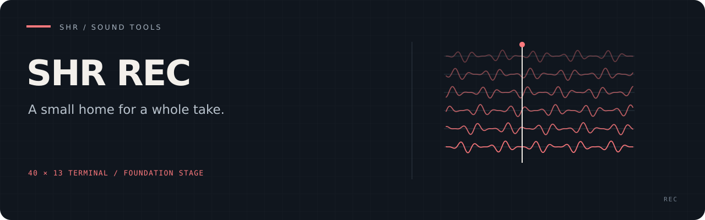

# SHR Rec

**Aligned multitrack recording for GigPies and standalone take playback in a 40×13 terminal.** The recording library writes a
separate 24-bit WAV for each channel, with take information and recovery support.

[**Current use and setup**](docs/LOCAL_SETUP.md) · [**GigPies guide**](https://github.com/gigpies/gigpies/blob/main/docs/README.md) · [Engineering](docs/ENGINEERING.md)

## What works

GigPies uses the raw recording library. The standalone application plays native
REC and SHR format-1 takes with synchronized transport, exact outputs or a stereo
audition mix. **Standalone Record, capture meters and MIDI remain unfinished.**
Do not use the standalone application to capture a take.

## Open the player

```sh
cargo build --locked --release
./target/release/shr-rec --takes-root /your/take-library
```

Touch TAKES → OPEN → OUTPUTS, assign destinations, then PLAY.
Keyboard and touch instructions are in the [operating guide](docs/LOCAL_SETUP.md).
Opening/browsing is read-only; playback attaches to an existing JACK server.

[Setup and configuration](docs/LOCAL_SETUP.md) · [Development status](docs/STATUS.md) · [MIT license](LICENSE)

[Contribute](https://github.com/gigpies/.github/blob/main/CONTRIBUTING.md) · [Report a bug](https://github.com/gigpies/shr-rec/issues/new/choose)
