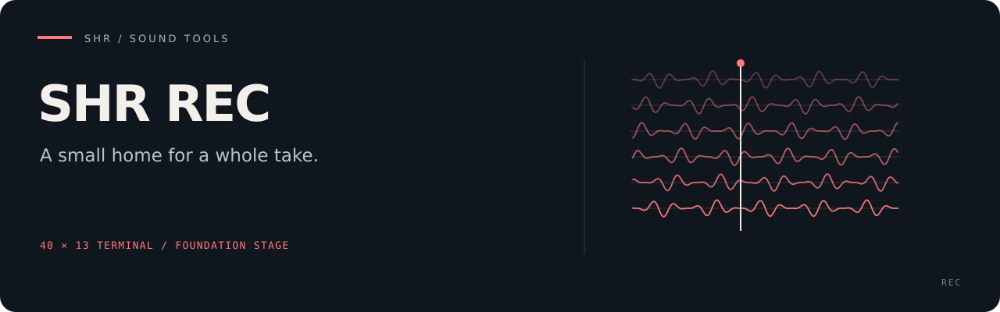

# SHR Rec

A standalone recorder/player project for Raspberry Pi and a **40×13** touch
terminal. Built around one take with aligned channel stems and a shared playback
timeline. Runs directly or as gadget `rec` from a launcher.

[Setup](docs/LOCAL_SETUP.md) · [Roadmap](docs/PLAN.md) · [Current behavior](docs/STATUS.md)

**Current status: shell plus an independent raw recording library.** The executable
provides input slots, session-only arming, private configuration, touch/keyboard
controls and clean Exit. The [raw recorder](docs/RAW_RECORDER.md) accepts host-supplied
samples through Rust or a versioned C ABI and writes aligned PCM24 stems with
explicit integrity and recovery. Shell recording, playback, meters and MIDI are
not connected.

## Try the current shell

```sh
cargo build --locked --release
mkdir -p "$HOME/.local/bin"
ln -s "$PWD/target/release/shr-rec" "$HOME/.local/bin/shr-rec"
shr-rec --help
shr-rec
```

The one-time link assumes `~/.local/bin` is on PATH and follows subsequent
release builds in this checkout. It refuses to replace an existing command.

Rust is pinned to **1.97.1**. No JACK server, audio client, MIDI connection,
service or launcher is started by this version. Existing terminal font and
console settings remain unchanged after exit.

Touch PREV/NEXT to select, ARM to toggle and EXIT to return to the caller.
Keyboard equivalents: arrows, Space, `s` for Stop, `q` or Escape for Exit.
RECORD and PLAY currently explain that the engine is not implemented.

## Documentation

- [Implementation plan](docs/PLAN.md)
- [Current behavior and validation](docs/STATUS.md)
- [Configuration and launcher boundary](docs/LOCAL_SETUP.md)
- [Architecture and remaining engine contracts](docs/ARCHITECTURE.md)
- [Reference provenance](THIRD_PARTY.md)
- [Raw recorder library and C ABI](docs/RAW_RECORDER.md)

Run normal software checks with `cargo test --locked --all-targets`; Python 3
and `mkfifo` are needed for isolated CLI/terminal regressions. Tests never open
JACK or MIDI. See the status document for acceptance limits.

MIT licensed; see [LICENSE](LICENSE).
